

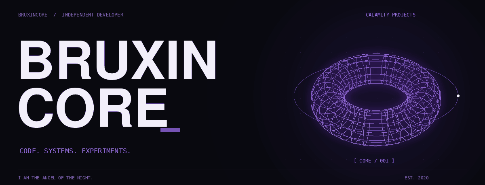

 

<a href="#core">01 / CORE</a> &nbsp;&nbsp;·&nbsp;&nbsp; <a href="#stack">02 / TECH ARSENAL</a>

  

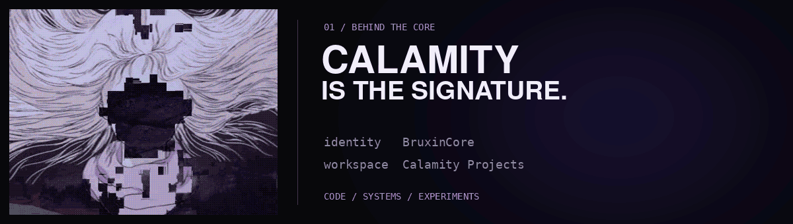

  <b>BruxinCore · Calamity Projects</b> 
  Código, sistemas e experimentos — do software ao hardware. 
  <i>I am the angel of the night.</i>

 

### 02 / Tech arsenal

Linguagens · formatos · ferramentas

#### Software / toolset

  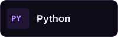
  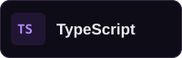
  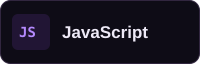
  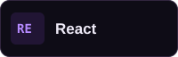
  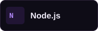
  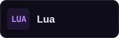
  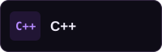
  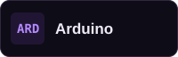
  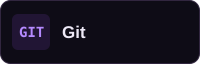

 

#### Android / ROM porting

  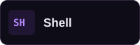
  
  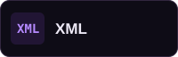

#### Kernel / build

  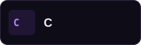
  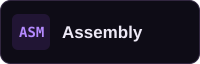
  
  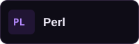
  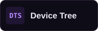

 

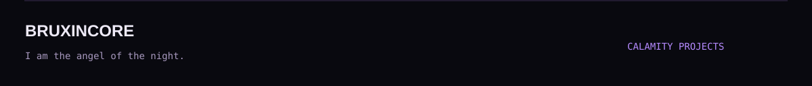
