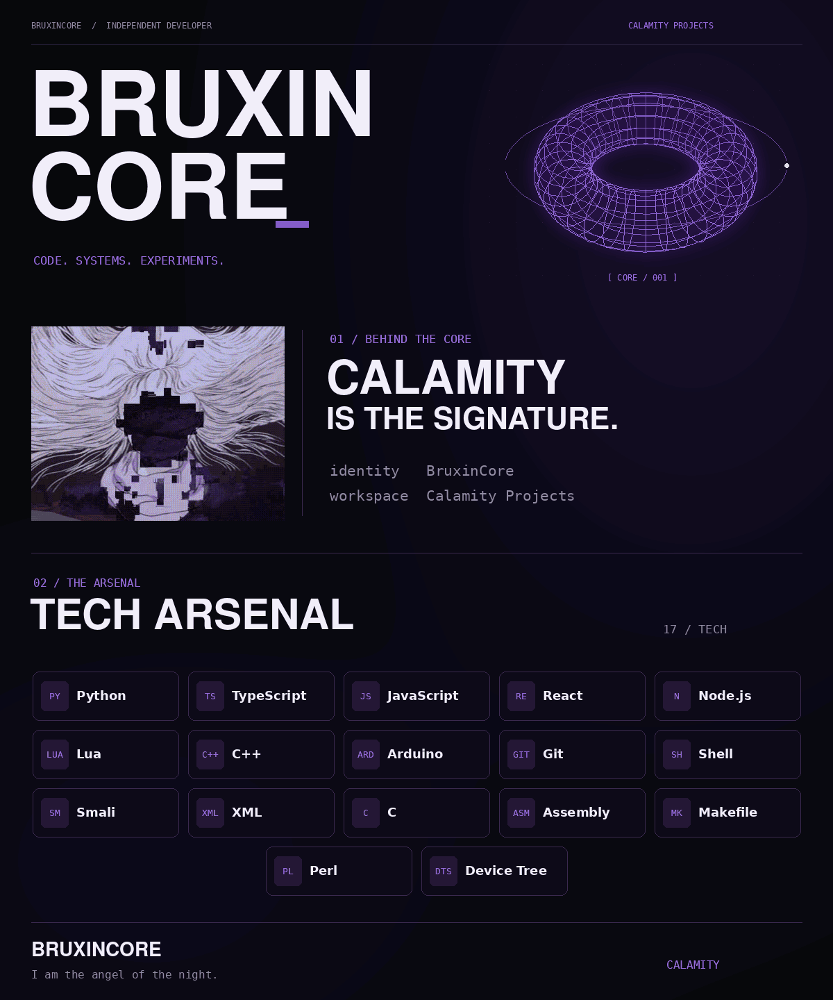

<picture>
  <source media="(prefers-reduced-motion: reduce) and (max-width: 600px)" srcset="./assets/profile-mobile-static.png" />
  <source media="(prefers-reduced-motion: reduce)" srcset="./assets/profile-static.png" />
  <source media="(max-width: 600px)" srcset="./assets/profile-mobile.gif" />
  
</picture>
